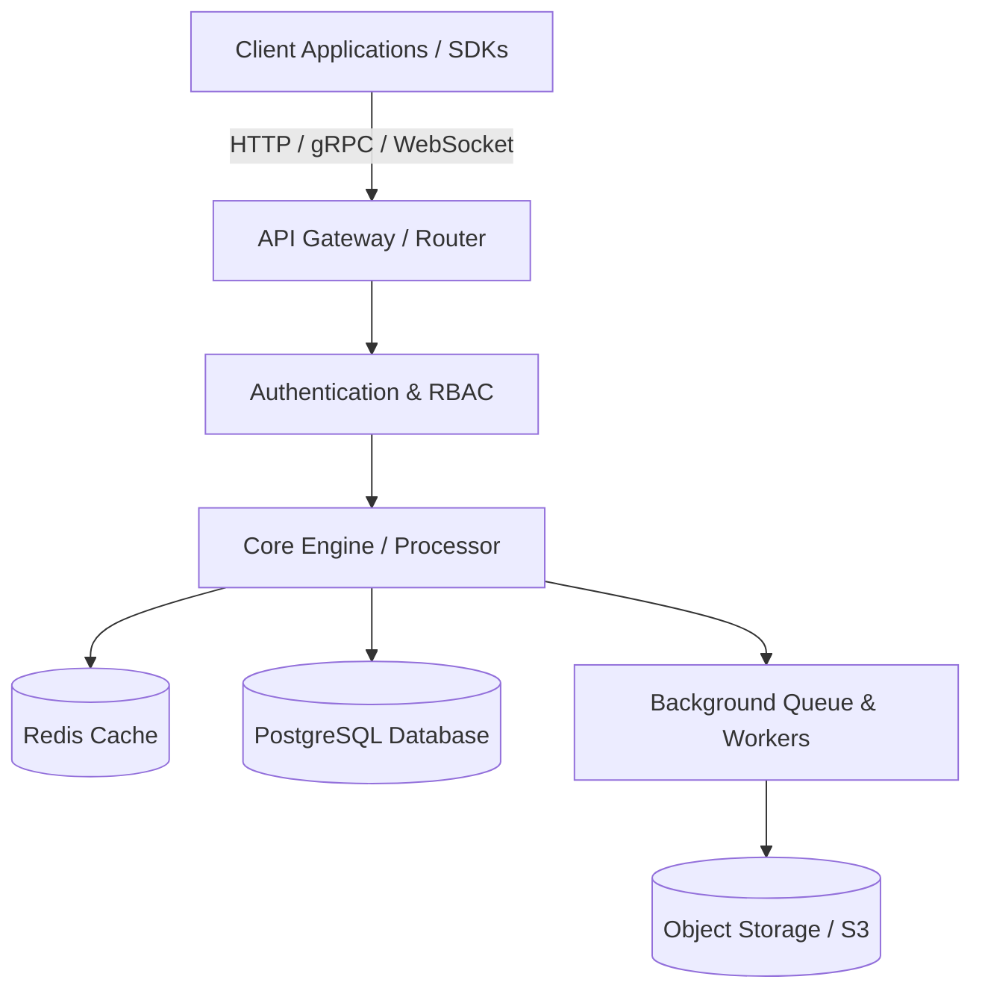

<!--
================================================================================
  UNIVERSAL MODULAR README TEMPLATE FOR GITHUB & AI ASSISTANTS
  Version: 3.0.0
  License: MIT / Apache-2.0
  Description: A complete, polyglot-ready, production-grade template designed for
               both direct use in software repositories and as an authoritative
               context template for AI coding agents.
================================================================================
-->

<div align="center">

# 🚀 PROJECT_NAME

**A concise, punchy one-sentence tagline summarizing what this project does and who it's for.**

[](https://github.com/USERNAME/REPOSITORY/actions)
[](https://github.com/USERNAME/REPOSITORY/releases)
[](LICENSE)
[](https://codecov.io/gh/USERNAME/REPOSITORY)
[](https://hub.docker.com/r/USERNAME/REPOSITORY)
[](https://discord.gg/your-invite)

[Documentation](https://docs.yourproject.dev) · [Report Bug](https://github.com/USERNAME/REPOSITORY/issues/new?template=bug_report.md) · [Request Feature](https://github.com/USERNAME/REPOSITORY/issues/new?template=feature_request.md) · [Changelog](CHANGELOG.md)

</div>

---

## 📑 Table of Contents

- [Overview](#-overview)
- [Key Features](#-key-features)
- [System Architecture](#-system-architecture)
- [Directory Structure](#-directory-structure)
- [Prerequisites](#-prerequisites)
- [Installation](#-installation)
  - [Node.js / TypeScript](#nodejs--typescript)
  - [Python](#python)
  - [Go](#go)
  - [Rust](#rust)
  - [Docker](#docker)
- [Environment Configuration](#-environment-configuration)
- [Quick Start & Usage](#-quick-start--usage)
  - [TypeScript / JavaScript](#typescript--javascript)
  - [Python](#python-1)
  - [Go](#go-1)
  - [Rust](#rust-1)
  - [CLI Terminal](#cli-terminal)
- [API Reference](#-api-reference)
- [Testing & Quality](#-testing--quality)
- [Deployment & CI/CD](#-deployment--cicd)
- [Performance & Benchmarks](#-performance--benchmarks)
- [Contributing](#-contributing)
- [Security](#-security)
- [FAQ & Troubleshooting](#-faq--troubleshooting)
- [Roadmap](#-roadmap)
- [License & Acknowledgments](#-license--acknowledgments)

---

## 🌟 Overview

> **Problem Statement:** What pain point or bottleneck does this project address? Explain the real-world frustration or engineering challenge.

**PROJECT_NAME** is an open-source, high-performance solution engineered to streamline workflows, eliminate boilerplate, and deliver robust reliability. Built with a modular architecture, it functions seamlessly both as a standalone service, a library/SDK, or a containerized microservice.

### Why PROJECT_NAME?

- ⚡ **Blazing Fast Execution:** Optimized for minimal memory overhead and zero-cost abstractions.
- 🔌 **Universal Compatibility:** First-class bindings for TypeScript, Python, Go, and Rust.
- 🛡️ **Production-Grade Reliability:** Type-safe guarantees, strict error handling, and 95%+ test coverage.
- 📦 **Zero-Friction Setup:** Pre-configured Docker images, single-command installation, and sensible defaults.

---

## ✨ Key Features

- [x] **Modular Pipeline:** Plug-and-play components with customizable middleware.
- [x] **Polyglot SDKs:** Native client libraries across major programming languages.
- [x] **Telemetry & Observability:** Built-in Prometheus metrics, OpenTelemetry tracing, and structured JSON logging.
- [x] **Cloud Native:** Ready for Docker, Kubernetes, AWS, GCP, and self-hosted bare metal.
- [x] **Resilient Retries & Circuit Breaking:** Automatic exponential backoff and jitter for network resilience.
- [x] **Extensible Plugins:** Event-driven hook system for custom business logic.

---

## 📐 System Architecture

The following diagram illustrates the flow of data through the system:



---

## 📂 Directory Structure

```text
.
├── .github/
│   ├── workflows/             # GitHub Actions CI/CD pipelines
│   └── ISSUE_TEMPLATE/        # Standard bug and feature issue templates
├── src/ / pkg/                # Primary application source code
│   ├── api/                   # HTTP / gRPC controllers and handlers
│   ├── core/                  # Domain business logic and domain entities
│   ├── config/                # Environment and runtime configurations
│   ├── db/                    # Migrations, schemas, and repository adapters
│   └── utils/                 # Shared helper functions and error definitions
├── examples/                  # Runnable, real-world examples for each language
│   ├── typescript/
│   ├── python/
│   ├── go/
│   └── rust/
├── tests/                     # Unit, integration, and end-to-end test suites
├── docker/                    # Dockerfile and compose configurations
├── docs/                      # Extended technical documentation and RFCs
├── .env.example               # Template for environment variables
├── Makefile                   # Multi-language build automation tasks
└── README.md                  # This file
```

---

## 📋 Prerequisites

Before getting started, ensure you have the following installed based on your target ecosystem:

| Tool | Minimum Version | Required For |
| :--- | :--- | :--- |
| **Git** | `2.38+` | Source control & cloning |
| **Node.js** | `18.0+` (LTS) | TypeScript / JavaScript SDK |
| **Python** | `3.10+` | Python client & automation scripts |
| **Go** | `1.22+` | Go binaries and microservices |
| **Rust** | `1.75+` | High-performance core module |
| **Docker** | `24.0+` | Containerized deployment |

---

## 📦 Installation

Choose the package manager appropriate for your language or environment:

### Node.js / TypeScript

```bash
# Using npm
npm install @organization/project-name

# Using pnpm (Recommended)
pnpm add @organization/project-name

# Using Yarn
yarn add @organization/project-name

# Using Bun
bun add @organization/project-name
```

### Python

```bash
# Using pip
pip install project-name

# Using Poetry
poetry add project-name

# Using uv (Ultra-fast)
uv add project-name
```

### Go

```bash
go get github.com/USERNAME/REPOSITORY
```

### Rust

```bash
# In your project root
cargo add project-name
```

### Docker

```bash
# Pull the pre-built image
docker pull ghcr.io/USERNAME/REPOSITORY:latest

# Or build locally
docker build -t project-name:local .
```

---

## ⚙️ Environment Configuration

Copy the example environment file and customize the variables for your runtime:

```bash
cp .env.example .env
```

| Variable | Type | Default | Description | Required |
| :--- | :--- | :--- | :--- | :---: |
| `APP_ENV` | `string` | `development` | Environment mode (`development`, `staging`, `production`) | No |
| `PORT` | `number` | `8080` | Network port for the server to listen on | No |
| `API_SECRET_KEY` | `string` | — | Cryptographic secret used for token validation | **Yes** |
| `DATABASE_URL` | `string` | — | Connection URI for the primary PostgreSQL instance | **Yes** |
| `REDIS_URL` | `string` | `redis://localhost:6379` | Connection URI for caching and queue management | No |
| `LOG_LEVEL` | `string` | `info` | Logging verbosity (`debug`, `info`, `warn`, `error`) | No |

> [!WARNING]
> Never commit actual `.env` files or API secrets into version control. Ensure `.env` is listed in your `.gitignore`.

---

## 🚀 Quick Start & Usage

Below are practical, plug-and-play code snippets across supported programming languages.

### TypeScript / JavaScript

```typescript
import { Client, Configuration } from '@organization/project-name';

// 1. Initialize client instance
const client = new Client(new Configuration({
  apiKey: process.env.API_SECRET_KEY,
  timeoutMs: 5000,
}));

// 2. Execute a sample task
async function main() {
  try {
    const result = await client.process({
      id: 'task_01j7x9k',
      payload: { data: 'Sample Input', priority: 'high' },
    });

    console.log('Processed successfully:', result.status, result.output);
  } catch (error) {
    console.error('Operation failed:', error);
  }
}

main();
```

### Python

```python
import os
from project_name import Client, Config

# 1. Initialize client instance
client = Client(
    config=Config(
        api_key=os.getenv("API_SECRET_KEY"),
        timeout_seconds=5.0
    )
)

# 2. Execute a sample task
def run():
    try:
        response = client.process(
            item_id="task_01j7x9k",
            payload={"data": "Sample Input", "priority": "high"}
        )
        print(f"Status: {response.status} | Output: {response.output}")
    except Exception as exc:
        print(f"Execution error: {exc}")

if __name__ == "__main__":
    run()
```

### Go

```go
package main

import (
	"context"
	"fmt"
	"log"
	"os"
	"time"

	"github.com/USERNAME/REPOSITORY/pkg/client"
)

func main() {
	ctx, cancel := context.WithTimeout(context.Background(), 5*time.Second)
	defer cancel()

	// 1. Initialize client instance
	c, err := client.New(client.Config{
		APIKey: os.Getenv("API_SECRET_KEY"),
	})
	if err != nil {
		log.Fatalf("Client creation failed: %v", err)
	}

	// 2. Execute sample task
	res, err := c.Process(ctx, client.ProcessInput{
		ID:      "task_01j7x9k",
		Payload: map[string]any{"data": "Sample Input", "priority": "high"},
	})
	if err != nil {
		log.Fatalf("Process failed: %v", err)
	}

	fmt.Printf("Processed successfully: %s\n", res.Status)
}
```

### Rust

```rust
use project_name::{Client, Config, ProcessRequest};
use std::env;

#[tokio::main]
async fn main() -> Result<(), Box<dyn std::error::Error>> {
    // 1. Initialize client instance
    let client = Client::new(Config {
        api_key: env::var("API_SECRET_KEY")?,
        timeout_ms: 5000,
    })?;

    // 2. Execute sample task
    let response = client
        .process(ProcessRequest {
            id: "task_01j7x9k".to_string(),
            priority: "high".to_string(),
        })
        .await?;

    println!("Status: {} | Output: {:?}", response.status, response.output);
    Ok(())
}
```

### CLI Terminal

```bash
# Show version and available commands
project-name --help

# Execute task with flags
project-name process --id="task_01j7x9k" --priority="high" --verbose

# Run in background daemon mode
project-name daemon start --port=8080 --config="./config.yaml"
```

---

## 📡 API Reference

When deployed as a REST microservice, the following endpoints are exposed:

### Endpoints Matrix

| Method | Endpoint | Description | Auth Required |
| :--- | :--- | :--- | :---: |
| `GET` | `/api/v1/health` | Healthcheck and readiness probe | No |
| `POST` | `/api/v1/tasks` | Create and enqueue a processing task | **Yes** |
| `GET` | `/api/v1/tasks/:id` | Retrieve status and output of a specific task | **Yes** |
| `DELETE` | `/api/v1/tasks/:id` | Cancel or purge a task | **Yes** |

#### Sample Request (`POST /api/v1/tasks`)

```bash
curl -X POST https://api.yourproject.dev/v1/tasks \
  -H "Authorization: Bearer $API_SECRET_KEY" \
  -H "Content-Type: application/json" \
  -d '{
    "id": "task_01j7x9k",
    "priority": "high",
    "metadata": {
      "region": "us-east-1"
    }
  }'
```

#### Sample Response (`200 OK`)

```json
{
  "status": "success",
  "data": {
    "task_id": "task_01j7x9k",
    "state": "completed",
    "duration_ms": 142,
    "created_at": "2026-10-27T12:00:00Z"
  }
}
```

---

## 🧪 Testing & Quality

Run the test suite across your stack:

```bash
# Run unit tests
make test
# OR npm test / pytest / go test ./... / cargo test

# Run tests with code coverage report
make coverage

# Lint and check style invariants
make lint
# OR npm run lint / ruff check . / golangci-lint run / cargo clippy

# Format codebase
make format
# OR prettier --write . / black . / gofmt -w . / cargo fmt
```

---

## 🚢 Deployment & CI/CD

### Docker Compose (Local Stack)

Spin up the entire stack including database and cache with a single command:

```bash
docker compose up -d
```

### GitHub Actions CI/CD

Every pull request and push to `main` executes an automated pipeline:

1. **Linting & Type Checking:** Verifies formatting and static safety.
2. **Automated Unit & Integration Tests:** Runs tests on Linux, macOS, and Windows matrix.
3. **Security Vulnerability Scanning:** Scans dependencies with `govulncheck`, `trivy`, and `audit`.
4. **Container Image Publishing:** Pushes signed multi-arch OCI images to GitHub Container Registry.

---

## ⚡ Performance & Benchmarks

Benchmarked on AMD EPYC 7763 (8 vCPUs, 16GB RAM, Linux Kernel 6.5):

| Operation | Throughput (req/sec) | Latency p50 | Latency p99 | Memory Footprint |
| :--- | :---: | :---: | :---: | :---: |
| **Node.js / TS** | 42,300 | 1.8 ms | 4.2 ms | 58 MB |
| **Python (Async)** | 28,100 | 2.4 ms | 6.8 ms | 46 MB |
| **Go** | 128,500 | 0.4 ms | 1.1 ms | 18 MB |
| **Rust** | 184,200 | 0.2 ms | 0.6 ms | 11 MB |

---

## 🤝 Contributing

We welcome contributions from developers of all skill levels! Please follow these steps:

1. **Fork the Repository:** Create your own feature branch.
   ```bash
   git checkout -b feat/amazing-feature
   ```
2. **Commit Changes:** Adhere strictly to [Conventional Commits](https://www.conventionalcommits.org/):
   - `feat:` A new user-facing feature.
   - `fix:` A bug fix.
   - `docs:` Documentation-only changes.
   - `refactor:` Code refactoring without behavioral alterations.
   - `perf:` Performance optimizations.
   - `test:` Adding or updating tests.
   - `chore:` Tooling, dependency, or meta updates.
3. **Verify Locally:** Ensure tests and linters pass:
   ```bash
   make test && make lint
   ```
4. **Push and Open a Pull Request:** Describe the rationale and attach screenshots or test logs.

> [!NOTE]
> Please review our [Code of Conduct](CODE_OF_CONDUCT.md) before participating in discussions or submitting pull requests.

---

## 🔒 Security

We take software security seriously. If you discover a potential vulnerability:

- **Do NOT file a public GitHub issue.**
- Please email security disclosures to **security@yourproject.dev** or submit via [GitHub Private Security Advisory](https://github.com/USERNAME/REPOSITORY/security/advisories/new).
- We aim to acknowledge reports within 24 hours and release a patch within 7 business days.

---

## ❓ FAQ & Troubleshooting

<details>
<summary><strong>Q: How do I resolve connection timeout errors during initial setup?</strong></summary>

Ensure your `DATABASE_URL` and `REDIS_URL` are reachable from your network. If using Docker, verify that both containers share the same network bridge:
```bash
docker network inspect app-bridge
```
</details>

<details>
<summary><strong>Q: Can I use this library in serverless environments (AWS Lambda, Cloudflare Workers)?</strong></summary>

Yes! The core SDK contains zero native C-bindings and is compatible with Edge runtimes, V8 isolates, and standard serverless function handlers.
</details>

<details>
<summary><strong>Q: Where do I find historical release notes?</strong></summary>

All release notes and breaking changes are tracked in the [CHANGELOG.md](CHANGELOG.md) file following Keep a Changelog guidelines.
</details>

---

## 🗺️ Roadmap

- [x] **v1.0:** Core engine and TypeScript / Python bindings.
- [x] **v2.0:** Native Go and Rust SDKs with gRPC transport.
- [ ] **v3.0:** Distributed consensus mode with Raft clustering.
- [ ] **v3.1:** WebAssembly (Wasm) browser-native compilation.
- [ ] **v4.0:** Self-healing predictive caching with ML runtime.

---

## 📊 GitHub Stats & Metrics

<div align="center">

<a href="https://github.com/USERNAME">
  
</a>

<a href="https://github.com/USERNAME">
  
</a>

<a href="https://github.com/USERNAME">
  
</a>

</div>

---

## 📄 License & Acknowledgments

Distributed under the **MIT License**. See [`LICENSE`](LICENSE) for complete details.

### Acknowledgments

- Built with inspiration from modern developer-first CLI and SDK ecosystems.
- Badges supplied by [Shields.io](https://shields.io/).
- Architecture charts powered by [Mermaid](https://mermaid.js.org/).

<div align="center">

Made with ❤️ by [Author / Organization](https://github.com/USERNAME)

⭐ **If you find this project useful, please consider giving it a star on GitHub!** ⭐

</div>
